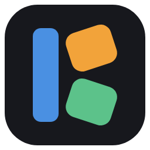
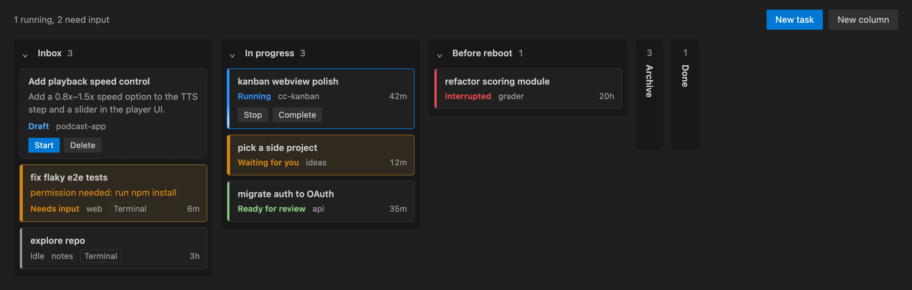

#  Agent Session Kanban

A kanban board for your [Claude Code](https://code.claude.com) sessions, right inside VS Code. Sort sessions into your own columns, see at a glance which ones are running and which are waiting for you, and click a card to attach to it in a terminal.



Nothing runs until you open the board. All data comes from the official Claude Code CLI (`claude agents --json`, `claude --bg`, `claude attach`, `claude stop`, `claude respawn`). The extension does not read Claude Code's internal files or host sessions itself. Background sessions keep running when you close VS Code.

## Features

- **Your columns.** **Inbox** (where new sessions land) and **Done** are built in. Add, rename (double-click), and delete your own columns. Drag cards between and within columns. Organizing never changes the session itself.
- **Live status.** Running, **Waiting for you** (Claude asked you something), Needs input (a prompt or permission request), Ready for review (Claude finished its turn), Interrupted (stopped by a shutdown or crash), Stopped, Idle. Once the board has been opened, the status bar shows how many sessions need you.
- **Click to attach.** A card opens `claude attach <id>` in a VS Code terminal. Closing the terminal only detaches. The session keeps running in the background.
- **Collapsible columns.** Collapse any column to a narrow strip that still shows its card count and how many need input. You can drop cards onto a collapsed column, so it works as a place for sessions you don't want to look at.
- **Card actions.** **Stop** stops the session process and keeps the card where it is. **Complete** moves the card to Done and stops the session if it is running. **Resume** brings a stopped or interrupted background session back with `claude respawn`, continuing the same conversation.
- **New tasks.** Write a title and instructions, pick a folder, and save it as a draft. **Start** launches it as a background session (`claude --bg`), and the card becomes a live session card in place.

## Requirements

- [Claude Code](https://code.claude.com) installed and signed in. The extension finds `claude` on your `PATH` or in common install locations such as `~/.local/bin/claude` (it only checks files; it never runs a shell to look). You can also set the path explicitly (see Settings).
- macOS or Linux.

## Usage

1. Run **Agent Session Kanban: Open Board** from the Command Palette, or click **Claude** in the status bar.
2. Your existing sessions appear in **Inbox**. Drag them into columns you create with **New column**.
3. Click a card to attach. Hover a card for **Stop**, **Complete**, or **Resume**.
4. Use **New task** to queue up work and **Start** it when you're ready.

## Notes and limitations

- Sessions started by typing `claude` directly in a terminal are shown with a **Terminal** tag, but the CLI cannot attach to them from elsewhere. Start sessions with `claude --bg`, from `claude agents`, or with **New task** to make them attachable.
- Starting a task in a folder Claude Code has never trusted fails with "Workspace not trusted". Run `claude` in that folder once and accept the prompt.
- Board layout is stored per machine in VS Code's global storage and shared by all windows on that machine.
- In a Remote (SSH / WSL / container) window the extension runs on the remote host and shows that host's sessions. Claude Code must be installed there.

## Settings

| Setting | Description |
|---|---|
| `claudeKanban.claudePath` | Absolute path to the `claude` CLI. Leave empty to auto-detect. |

## Development

```bash
npm install
npm test            # unit tests (vitest)
npm run typecheck
npm run test:e2e    # smoke test in a real VS Code
npm run test:real   # round-trip against the real claude CLI: starts one tiny session, then removes it
npm run package     # builds agent-session-board-<version>.vsix
```

## License

[MIT](LICENSE)

This is an unofficial community extension. It is not affiliated with, endorsed by, or sponsored by Anthropic. "Claude" and "Claude Code" are trademarks of Anthropic, PBC, and are used here only to describe what the extension works with.
